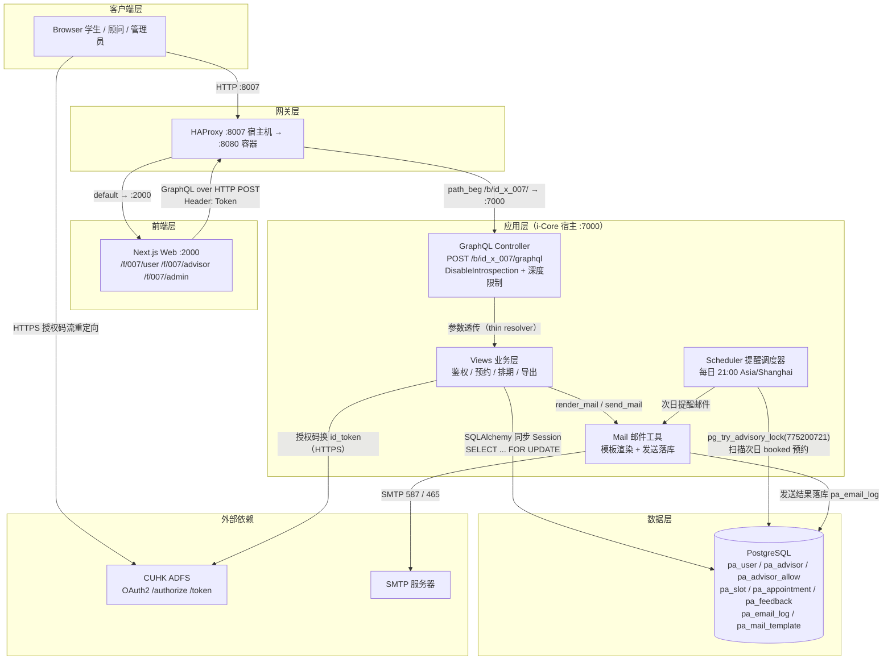
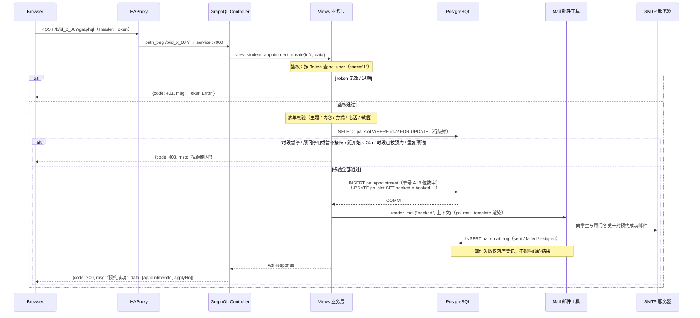

<div align="center">

# id_x_007: UGO 咨询预约系统

**顾问建档 — 排期发布 — 学生预约 — 邮件提醒 — 反馈统计，一站式朋辈咨询预约平台**


</div>

---

## 1. 简介 (Introduction)

- **Slogan**: 为高校朋辈辅导场景打造的排期与预约一站式平台 —— 管理端统一排期，学生一键预约，系统自动提醒。
- **Description**: id_x_007 是运行于 **i-Core 可插拔内核**之上的业务插件模块，面向大学生事务办公室（UGO, University General Office）的朋辈顾问（Peer Consultant）咨询业务。系统打通「顾问建档 → 排期发布（单条新增 / Excel 批量导入）→ 学生浏览预约 → 每日定时提醒 → 取消 / 完成 / 反馈 → 运营统计导出」完整业务闭环。后端以 Litestar + Strawberry GraphQL 暴露单一 GraphQL 端点（`/b/id_x_007/graphql`），数据落 PostgreSQL `pa_*` 八张业务表；前端为 Next.js App Router + HeroUI 的中英双语站点（路由前缀 `/f/007`）；入口由 HAProxy 统一按路径分流。相比通用预约工具，本系统内建 CUHK ADFS 统一身份认证（OAuth2 授权码流）、数据库行级锁防超订、库表驱动的邮件模板体系与 advisory lock 防重的定时提醒调度器，可在多 worker 生产环境下直接部署。

## 2. 核心特性 (Features)

- **顾问建档与排期管理**：管理员创建顾问档案（年级 / 专业 / 擅长方向 / 简介 / 照片）；顾问经 SSO 登录顾问门户自助管理本人咨询时段，管理员亦可在「排期管理」中代管：单条增删改、暂停 / 恢复、「暂不接待」整体开关，以及 Excel（.xlsx）批量导入排期（逐行校验、失败行报告、同时段 upsert）。
- **学生浏览与预约**：按专业 / 方向筛选顾问卡片，查看未来可约时段；预约须在开始前 24 小时之前提交，取消（学生侧 / 顾问侧或管理端代顾问）须填写取消原因、在开始前 4 小时内禁止；时段占用（每时段 1 人）与重复预约经数据库行级锁（`SELECT ... FOR UPDATE`）校验，并发下不超订。
- **三类邮件通知**：预约成功（booked）、取消（cancelled）、每日提醒（reminder）三类邮件经 `pa_mail_template` 库表模板渲染（管理员可在线配置文案，缺失回退内置默认），发送结果无论成败均落库 `pa_email_log` 登记；每日 21:00（Asia/Shanghai）调度器扫描次日预约发送提醒，以 PostgreSQL advisory lock 防多 worker 重复发送。
- **双通道身份认证**：学生与朋辈顾问经 CUHK ADFS 统一身份认证（OAuth2 授权码流，id_token 服务端验签；登录账号命中管理员预建且启用中的顾问档案即为 advisor，否则建档为 student；经 `/admin-login` 的 Consultant SSO Login 登录须过 `pa_advisor_allow` 白名单（邮箱在名单中且 allow=TRUE），通过后以 advisor 角色进入管理后台（「权限管理」模块仅 admin 可见）；学生经 `/user-login` 登录不受白名单限制、按顾问档案定角色；白名单经管理后台「权限管理」页维护，支持增删改与勾选允许/禁止）
- **管理后台数据域隔离**：advisor 角色在后台仅能查看 / 检索 / 修改 / 导入 / 导出本人的档案、排期、预约、反馈、统计与邮件日志（后端按本人顾问档案强制过滤，忽略入参 advisorId）；顾问新增 / 删除、邮件模板配置、权限管理（白名单）仅 admin；admin 可查看并操作所有顾问的数据；管理员账号密码登录采用 RSA-2048 传输加密 + 防爆破锁定（默认 5 次失败锁定 10 分钟）+ 连续失败后 SVG 图形验证码。顾问经顾问门户（`/f/007/advisor`）自助管理本人排期与预约，管理后台亦可代管。
- **运营统计与导出**：预约总量 / 完成 / 取消 / 进行中统计与各顾问咨询量排名；预约明细与反馈汇总支持按顾问 / 月份过滤的 Excel 导出（base64 下载），顾问可导出本人历史预约数据；认证 / 变更 / 导出等敏感操作写入 JSON Lines 审计日志（按天轮转）。

## 3. 项目亮点 (Highlights)

1. **行级锁防超订的并发预约内核** —— 预约与取消均先对 `pa_slot` 行执行 `with_for_update()` 加锁，再校验占用（`booked < 1`，每时段 1 人）、24 小时截止与重复预约，保证高并发场景下占用计数严格一致，杜绝超订。
2. **advisory lock 防重的定时提醒调度** —— 每日 21:00 的提醒任务执行前先竞争 PostgreSQL 会话级咨询锁 `pg_try_advisory_lock(775200721)`，多 worker 部署下仅一个进程实际发送，业务逻辑经 `asyncio.to_thread` 跑在线程池中不阻塞事件循环，单轮异常不终止调度循环。
3. **库表驱动的邮件模板体系** —— 三类邮件主题与正文 HTML 存于 `pa_mail_template`（支持 `{apply_no}` 等占位符），管理员可在线 upsert 文案；建表时幂等播种默认模板，渲染时缺失回退代码内置默认；SMTP 未配置时跳过发送但仍落库 `status="skipped"`，便于上线后补查。
4. **纵深登录安全闭环** —— 登录凭据经 RSA-2048（OAEP-SHA256）端到端加密传输；口令以 PBKDF2 哈希落库且旧明文自动迁移；防爆破计数锁定 + 连续失败触发一次性 SVG 验证码；对不存在用户执行 DUMMY_HASH 校验抹平时序，防用户名枚举。
5. **GraphQL 面收紧加固** —— 关闭 introspection（DisableIntrospection）、限制查询深度（QueryDepthLimiter, max_depth=8）、禁用 GraphiQL IDE、仅接受 POST 查询，显著缩小攻击面。
6. **SSO 身份闭环** —— ADFS 授权码流换取 id_token 后服务端验签（含 nonce 防重放），只向前端签发独立会话 Token、不暴露 IdP 凭据；凭据配置（client_id / client_secret / redirect_uri）存 `pa_sso_settings` 表，运行期改表即生效。
7. **可追溯的用户行为审计** —— 认证 / 排期变更 / 预约操作 / 导出等关键动作统一写入 `logs/id_x_007_audit.log`（JSON Lines，按天轮转，保留 14 天自动清理），满足事后追责与合规审查。
8. **一键幂等的容器编排** —— `ops/up.sh` 以 Podman Pod 形式幂等拉起 service / web / haproxy 三容器（已存在即跳过），亦提供 `podman-compose.yml` 等价编排；数据库直连外部 PostgreSQL（`ops/.env` 的 `DB_*`），建表与管理员 / 邮件模板 / SSO 配置播种全部幂等，可重复执行。

## 4. 技术栈 (Tech Stack)

<p align="center">表 4-1 技术栈一览</p>

| 分类 | 名称 | 版本 | 用途 |
|------|------|------|------|
| 编程语言 | Python | ≥ 3.10 | 后端业务实现 |
| 编程语言 | TypeScript | 5 | 前端实现 |
| 后端框架 | Litestar | ≥ 2.24 | ASGI 路由与控制器（经 i-Core 宿主托管） |
| API 规范 | Strawberry GraphQL | ≥ 0.323 | GraphQL Schema 与 resolver |
| ORM | SQLAlchemy | ≥ 2.0 | 同步 Session 数据访问（psycopg2） |
| 数据库 | PostgreSQL | 18 | 主存储（`pa_*` 七表，行锁 / advisory lock） |
| 前端框架 | Next.js（App Router） | ^16.0 | 前端站点（端口 2000，路由前缀 `/f/007`） |
| UI 组件库 | HeroUI + Tailwind CSS | ^3.2 / ^4.0 | 界面组件与样式 |
| 国际化 | next-intl | ^4.14 | 中英双语 |
| 数据处理 | pandas / openpyxl | — | Excel 批量导入与导出 |
| 反向代理 | HAProxy | 3.0 | 按路径分流 API 与前端，TLS 终止（可选） |
| 容器化 | Podman / podman-compose | — | `ops/` 下一键编排部署 |

## 5. 整体架构图 (Overall Architecture Diagram)



<p align="center">图 5-1 id_x_007 整体架构图</p>

## 6. 请求流转图 (Request Flow Diagram)

以「学生预约咨询时段（`studentAppointmentCreate`）」为例，展示一次完整请求的生命周期：



<p align="center">图 6-1 学生预约请求流转图</p>

## 7. 目录结构 (Directory Structure)

```text
id_x_007/
├── x_plugin.py                  # i-Core 插件适配层：建表播种 / 同步会话工厂桥接 / 启动调度器
├── __init__.py
├── src/                         # 后端业务源码
│   ├── controllers/
│   │   └── x_controllers.py     # 路由层：GraphQL Query/Mutation thin resolver + 安全加固
│   ├── views/
│   │   └── x_views.py           # 业务层：鉴权 / 预约 / 排期 / 管理后台 / 导出全部逻辑
│   ├── models/
│   │   └── x_models.py          # 数据层：pa_* 七表 ORM + 管理员与邮件模板幂等播种
│   ├── schemas/
│   │   └── x_schemas.py         # GraphQL 输入 / 输出类型定义
│   └── utils/
│       ├── x_oauth.py           # CUHK ADFS OAuth2：授权码换 token / id_token 验签
│       ├── x_crypto.py          # 登录传输加密：RSA-2048 密钥对与字段解密
│       ├── x_security.py        # 口令安全：PBKDF2 哈希 / 校验 / 时序抹平
│       ├── x_mail.py            # 邮件：模板渲染 + SMTP 发送 + pa_email_log 落库
│       ├── x_scheduler.py       # 定时调度：每日 21:00 次日预约提醒（advisory lock 防重）
│       └── x_audit.py           # 用户行为审计日志（JSON Lines，按天轮转）
├── web/                         # 前端（Next.js App Router，端口 2000）
│   ├── src/app/f/007/           # 页面路由：admin-login / user-login(仅 SSO) / login(旧路径重定向) / user/oauth2(SSO 回调) / user / advisor / admin
│   ├── src/views/               # 页面视图组件（预约 / 排期 / 统计 / 邮件日志等）
│   ├── src/api/                 # GraphQL 客户端封装（user / advisor / admin）
│   ├── src/components/          # 布局与通用 UI 组件
│   ├── src/i18n/                # 中英双语文案
│   ├── src/utils/               # 配置 / SSO 跳转 / 加密 / 下载等工具
│   └── Dockerfile               # 前端镜像（node:24-alpine，yarn build + start）
├── ops/                         # 部署编排
│   ├── up.sh                    # 一键启动（Podman Pod，幂等）
│   ├── down.sh                  # 一键停止清理
│   ├── podman-compose.yml       # compose 等价编排（service / web / haproxy，直连外部库）
│   ├── Dockerfile.service       # 后端镜像（构建上下文为仓库根目录）
│   ├── haproxy.cfg              # 网关：/b/id_x_007/ → 后端 :7000，其余 → 前端 :2000
│   ├── .env.example             # 环境变量样例（复制为 .env 后修改）
│   ├── init/                    # 数据库初始化 SQL（手动初始化外部库参考，应用启动会自动建表播种）
│   └── engine_compat/           # 容器内 PostgreSQL 兼容覆盖（配置 / DB 工具 / 依赖清单；连接外部库）
├── scripts/
│   └── reset_admin_password.py  # 运维脚本：重置管理员口令
├── docs/                        # 需求文档（docx）
└── LICENSE                      # AGPL-3.0 协议
```

## 8. API 接口文档 (API Documentation)

对外仅暴露单一 GraphQL 端点（经 HAProxy 转发）：

- **端点**：`POST /b/id_x_007/graphql`（仅 POST；introspection 与 GraphiQL 已禁用）
- **鉴权**：登录后将返回的会话 Token 置入请求头 `Token: <TOKEN>`；无需鉴权的操作仅 `health`、`loginKey`、`login`、`register`、`oauthLogin`。
- **响应约定**：业务操作统一返回 `ApiResponse { code, msg, data }`（`data` 为 JSON 字符串）；文件下载返回 `FileResponse { code, msg, fileName, fileBase64 }`。常见业务码：200 成功、400 参数错误、401 未登录 / 凭据错误、403 禁止（时段已订 / 截止 / 越权）、404 不存在、409 冲突、423 账号锁定、428 需要验证码、500 服务器错误。

### 8.1 Query 汇总（18 个）

<p align="center">表 8-1 GraphQL Query 汇总</p>

| 操作名 | 鉴权 | 说明 |
|--------|------|------|
| health | 无 | 健康检查 |
| loginKey | 无 | 下发登录传输加密公钥（RSA-2048 PEM） |
| advisorList | 登录 | 顾问卡片列表（含每人未来可约时段 ≤ 5 条与专业 / 方向筛选项） |
| advisorSlotList | 登录 | 指定顾问的全部可约时段 |
| myAppointmentList | 登录 | 我的预约列表（分页，附可取消标记） |
| advisorMySlotList | admin / advisor | 顾问排期列表（advisor 本人；admin 代管须传 advisorId；含暂停时段） |
| advisorSlotTemplate | admin / advisor | 批量排期模板下载（xlsx：日期 / 开始时间 / 结束时间） |
| advisorAppointmentList | admin / advisor | 顾问预约明细（advisor 仅本人；admin 代管须传 advisorId；可按日期 / 状态筛选） |
| advisorAppointmentExport | admin / advisor | 顾问个人历史预约导出（advisor 仅本人；可按月份过滤） |
| manageAdvisorList | admin 全量 / advisor 仅本人 | 顾问列表（keyword 匹配姓名 / 用户名 / 专业 / 方向） |
| manageAllowList | admin | 顾问 SSO 登录白名单列表（keyword 匹配邮箱） |
| manageAppointmentList | admin 全量 / advisor 仅本人 | 预约明细（可按顾问 / 日期 / 状态筛选） |
| manageFeedbackList | admin 全量 / advisor 仅本人 | 反馈列表（可按顾问 / 月份筛选） |
| manageStats | admin 全量 / advisor 仅本人口径 | 运营统计：总量 / 完成 / 取消 / 进行中 + 顾问咨询量排名 |
| manageEmailLogList | admin 全量 / advisor 仅本人预约关联 | 邮件发送日志（可按类型筛选） |
| manageMailTemplateList | admin | 邮件模板列表（booked / cancelled / reminder 三类） |
| manageAppointmentExport | admin 全量 / advisor 仅本人 | 预约导出（可按顾问 / 月份过滤） |
| manageFeedbackExport | admin 全量 / advisor 仅本人 | 反馈汇总导出（可按顾问 / 月份过滤） |

### 8.2 Mutation 汇总（22 个）

<p align="center">表 8-2 GraphQL Mutation 汇总</p>

| 操作名 | 鉴权 | 说明 |
|--------|------|------|
| login | 无 | 账号密码登录（仅 admin，student/advisor 走 SSO；RSA 加密凭据 / 验证码 / 防爆破锁定） |
| register | 无 | 管理员自助注册（注册后待运维登库激活） |
| logout | 登录 | 登出（失效会话 Token） |
| oauthLogin | 无 | CUHK SSO 登录（ADFS 授权码流；顾问入口须过 pa_advisor_allow 白名单、通过后签发 advisor 会话进入管理后台；学生入口不校验白名单、按顾问档案定 advisor/student；首次登录自动建档） |
| studentAppointmentCreate | student | 学生预约（24h 截止 / 行锁占用校验 / 重复拦截 / 双方邮件通知） |
| studentAppointmentCancel | 登录 | 学生取消预约（须填取消原因；开始前 4 小时内禁止；双方邮件通知） |
| advisorSlotCreate | admin / advisor | 新增咨询时段（advisor 本人；admin 代管须传 advisorId） |
| advisorSlotUpdate | admin / advisor | 修改咨询时段（起止时间） |
| advisorSlotDelete | admin / advisor | 删除咨询时段（存在预约记录时拒绝） |
| advisorSlotState | admin / advisor | 暂停 / 恢复咨询时段 |
| advisorSlotBatchUpload | admin / advisor | 批量上传排期（xlsx，逐行校验返回成功 / 失败行报告） |
| advisorAcceptingSet | admin / advisor | 设置顾问「暂不接待」整体开关 |
| advisorAppointmentCancel | admin / advisor | 顾问取消预约（须填原因；开始前 4 小时内禁止） |
| advisorAppointmentComplete | admin / advisor | 标记咨询完成（开始时间已过方可） |
| feedbackSet | admin / advisor | 填写 / 更新咨询反馈（仅 completed 预约，upsert） |
| manageAdvisorCreate | admin | 创建顾问（仅建顾问档案，不建用户账号） |
| manageAdvisorUpdate | admin 任意 / advisor 仅本人 | 更新顾问档案（留空字段不变） |
| manageAdvisorDelete | admin | 删除顾问（有预约记录时拒绝并提示停用） |
| manageAllowCreate | admin | 新增白名单记录（邮箱唯一，不区分大小写） |
| manageAllowUpdate | admin | 更新白名单记录（邮箱 / 允许状态，留空不变） |
| manageAllowDelete | admin | 删除白名单记录（移除后该顾问邮箱无法 SSO 登录） |
| manageMailTemplateUpdate | admin | 邮件模板更新（按类型 upsert 主题与正文） |

### 8.3 详细示例

#### 8.3.1 管理员登录（login）

请求（凭据为 `loginKey` 下发的 RSA 公钥加密后的密文；明文联调可置 `encrypted: false`）：

```graphql
mutation Login {
  login(data: {
    username: "<RSA_ENCRYPTED_USERNAME>"
    password: "<RSA_ENCRYPTED_PASSWORD>"
    encrypted: true
    captchaId: ""
    captchaCode: ""
  }) {
    code
    msg
    data
  }
}
```

成功响应（`data` 为 JSON 字符串）：

```json
{
  "data": {
    "login": {
      "code": 200,
      "msg": "Login Success",
      "data": "{\"user_id\": \"1\", \"token\": \"<TOKEN>\", \"role\": \"admin\", \"name\": \"管理员\", \"username\": \"admin\"}"
    }
  }
}
```

异常分支：401 账号或密码错误（连续失败达阈值后随响应下发 `need_captcha` 与验证码图）；423 账号锁定中；428 需要验证码；403 学生账号尝试密码登录 / 账号停用 / 待激活。

#### 8.3.2 学生预约（studentAppointmentCreate）

```graphql
mutation StudentAppointmentCreate {
  studentAppointmentCreate(data: {
    slotId: 12
    topic: "选课咨询"
    content: "想了解大二专业选修课搭配"
    mode: "online"
    phone: "13800000000"
    wechat: "wx_demo"
    meetingLink: ""
  }) {
    code
    msg
    data
  }
}
```

成功返回 `{"appointmentId": 34, "applyNo": "A12345678"}`；异常码：401 未登录、400 表单校验失败、403 时段暂停 / 顾问暂不接待 / 距开始不足 24 小时 / 时段已被预约 / 重复预约、404 时段不存在。

#### 8.3.3 curl 调用示例

```bash
# 1. 健康检查（无需鉴权；<BASE_URL> 如 http://localhost:8007）
curl -X POST "<BASE_URL>/b/id_x_007/graphql" \
  -H "Content-Type: application/json" \
  -d '{"query": "query { health { status service } }"}'

# 2. 携带会话 Token 查询顾问卡片列表（<TOKEN> 替换为登录返回的 token）
curl -X POST "<BASE_URL>/b/id_x_007/graphql" \
  -H "Content-Type: application/json" \
  -H "Token: <TOKEN>" \
  -d '{"query": "query { advisorList(data: {page: 1, pageSize: 10, major: \"\", direction: \"\"}) { code msg data } }"}'

# 3. 管理端运营统计（需 admin 角色 Token）
curl -X POST "<BASE_URL>/b/id_x_007/graphql" \
  -H "Content-Type: application/json" \
  -H "Token: <TOKEN>" \
  -d '{"query": "query { manageStats { code msg data } }"}'
```

## 9. 快速部署 (Quick Deploy)

### 9.1 环境准备 (Prerequisites)

- **容器部署（推荐）**：Podman ≥ 4.x（或 podman-compose），无需本机 Python / Node 环境。
- **本地裸跑**：Python ≥ 3.10 + uv（后端，经 i-Core 宿主启动）、Node.js ≥ 24 + yarn（前端）、PostgreSQL ≥ 14。
- 预约提醒依赖容器 / 进程时区为 `Asia/Shanghai`（部署脚本与镜像已内置）。

### 9.2 安装 (Installation)

```bash
# 克隆 i-Core 仓库（本模块为其插件，须在仓库内构建）
git clone <I_CORE_REPO_URL> && cd i-Core/x_models/id_x_007

# 准备环境变量（首次执行 up.sh 也会自动生成 .env 模板）
cp ops/.env.example ops/.env
# 编辑 ops/.env：外部数据库 DB_* 等；SSO/SMTP 配置存库（pa_sso_settings / pa_smtp_settings，启动自动播种）
```

### 9.3 运行 (Run)

容器一键启动（Podman Pod，幂等，推荐）：

```bash
bash ops/up.sh            # 首次自动构建镜像并拉起 service / web / haproxy（数据库直连外部库）
bash ops/up.sh --build    # 代码变更后强制重建镜像
# 启动完成: http://localhost:8007 （前端），API 经 http://localhost:8007/b/id_x_007/graphql
bash ops/down.sh          # 停止并清理全部容器与 Pod
```

本地裸跑（联调开发）：

```bash
# 后端：在 i-Core 仓库根目录，确认 config/base_config.toml [EXTEND].MODELS
# 含 ["id_x_007", "/id_x_007"] 后启动宿主（监听 7000）
uv run python main.py

# 前端：web 目录（Next.js dev，监听 2000，经 BACKEND_URL 反代后端）
cd web && cp .env.local.example .env.local && yarn install && yarn dev
```

关键环境变量（完整清单见 `ops/.env.example`）：

<p align="center">表 9-1 关键环境变量</p>

| 变量 | 说明 |
|------|------|
| DB_HOST / DB_PORT / DB_NAME / DB_USERNAME / DB_PASSWORD | 外部 PostgreSQL 连接配置（部署不再内置 db 容器；本机库可填 host.containers.internal） |
| ADMIN_USERNAME / ADMIN_PASSWORD | 初始管理员兜底播种（留空默认 admin / admin123） |

SSO 凭据与 SMTP 邮件配置均已移入数据库（`pa_sso_settings` / `pa_smtp_settings` 表，应用启动自动播种，改表即生效，不走环境变量）；提醒调度默认开启；上传上限固定 32MB；审计日志固定保留 14 天。

### 9.4 容器部署 (podman-compose)

```bash
cd ops
podman-compose up -d --build   # 等价编排：service(7000) / web(2000) / haproxy(8007:8080)，数据库直连外部库
podman-compose down            # 停止
```

端口约定：宿主机 `8007` 为统一入口（HAProxy 容器内 `8080`；`/b/id_x_007/` 前缀转后端 `7000`，其余转前端 `2000`）。数据库为外部 PostgreSQL（`ops/.env` 的 `DB_*` 配置），运维登库（如激活自助注册的管理员、执行 `scripts/reset_admin_password.py`）直接连接外部库即可；表结构与预置数据（管理员 / 邮件模板 / SSO 配置）由应用启动时幂等创建，`ops/init/*.sql` 仅供手动初始化参考。
