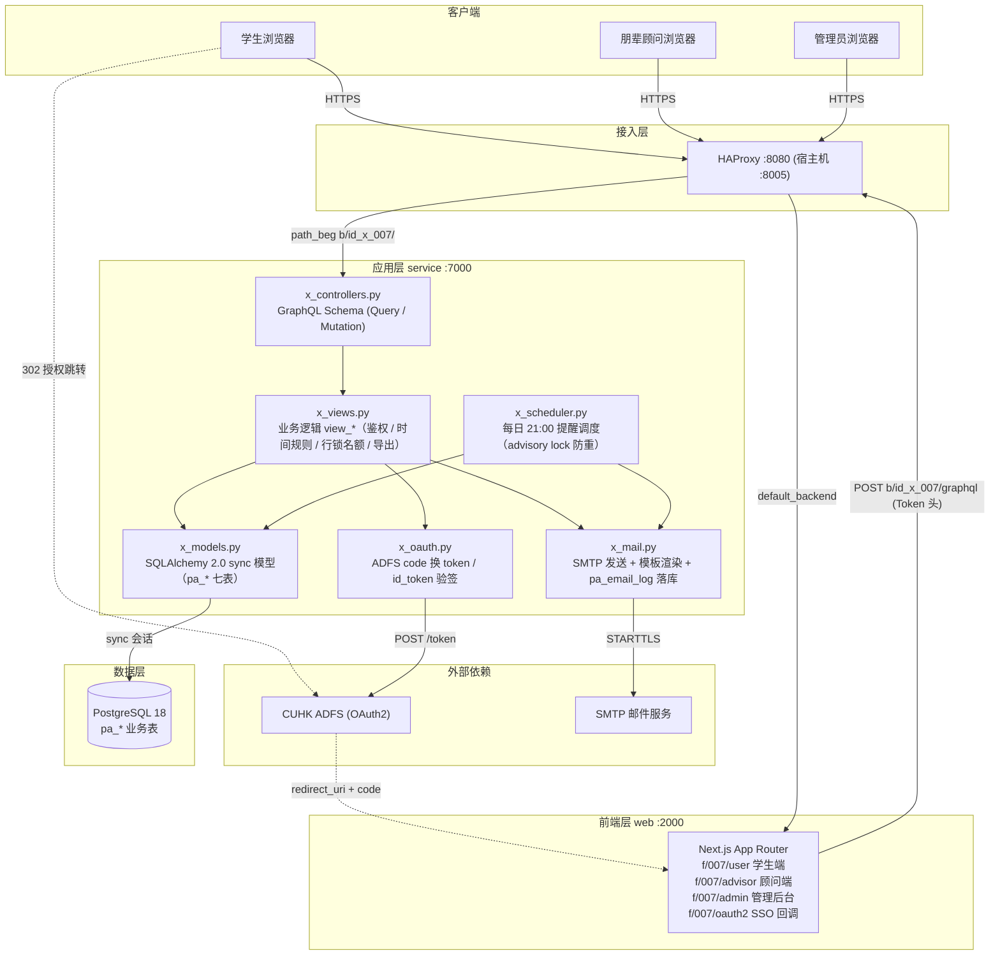
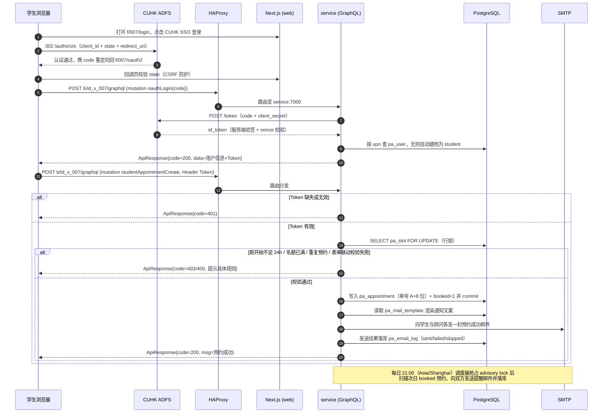

<div align="center">

# id_x_007: UGO 朋辈顾问咨询预约系统（Peer Advisor Appointment）

**把"找朋辈顾问咨询"从邮件/微信沟通，升级为自助式在线预约闭环**


</div>

---

## 1 简介 (Introduction)

**Slogan**：为经管学院「朋辈顾问咨询（Peer Advisor, PA）」项目提供顾问展示、时段排期、预约报名、邮件通知、取消与反馈、数据汇总导出的一站式线上平台。

**Description**：本项目覆盖**顾问建档 → 排期发布（单条/批量导入）→ 学生浏览与预约 → 邮件通知与每日提醒 → 取消/完成/反馈 → 统计分析与 Excel 导出**的完整业务闭环。学生与朋辈顾问经 CUHK 统一身份认证（Single Sign-On, SSO）登录，首次登录自动建档，无需注册；管理员以账号密码登录后台，维护顾问档案、代管排期并掌握全量预约、反馈与邮件数据。

与人工登记表或邮件协调相比，本系统的优势在于：

- 时间规则内建：报名截止（咨询开始前 24 小时）、学生/顾问取消截止（开始前 4 小时）等规则均由服务端强制执行；
- 名额并发安全：预约提交对时段行加锁（`SELECT ... FOR UPDATE`）后校验名额与重复预约，杜绝并发超订；
- 通知全程留痕：预约成功、取消、每日提醒三类邮件全部落库 `pa_email_log`（含 skipped/failed 状态），管理端可查可审计；
- 以插件形式接入 i-Core 宿主框架（实现 `PluginInterface`，懒加载内部模块），与其他业务模块共享数据库会话与日志基础设施。

## 2 核心特性 (Features)

- **学生端自助预约**：按专业/擅长方向筛选浏览顾问卡片（照片、年级、专业、擅长方向、简介、近期可约时段），选时段填写咨询表单（主题/内容/线上线下方式/电话/微信/会议链接，表单按方式联动校验），一键生成预约单号（`A` + 8 位数字）；开始前 4 小时外可自助取消。
- **顾问端排期管理**：单条增删改、暂停/恢复时段、名额控制（默认 1 人）、xlsx 模板下载与批量导入（逐行校验并返回成功/失败行报告）、「暂不接待」整体开关；预约处理支持取消（必填原因）、标记完成与填写咨询反馈（总结/处理方式/是否跟进，仅顾问与管理员可见）。
- **管理端全量运营**：顾问账号与档案管理、任意顾问排期代管、全量预约/反馈查询与 Excel 导出（可按顾问/月份过滤）、运营统计（总量/完成/取消/进行中 + 顾问咨询量排名）、邮件日志查看与邮件模板在线配置。
- **邮件通知闭环**：预约成功/取消即时通知双方；每天 21:00（Asia/Shanghai）自动扫描次日预约并向双方发送提醒；SMTP 未配置时自动降级为仅落库不发送，上线后可补查。
- **双通道登录**：学生/顾问走 CUHK SSO（ADFS OAuth2 授权码流，首次登录自动建档）；管理员账号密码登录（RSA-2048 加密传输 + PBKDF2 口令哈希 + 防爆破验证码）。

## 3 项目亮点 (Highlights)

1. **预约并发安全** —— 预约与取消均对 `pa_slot` 行执行 `with_for_update()` 行级锁后再校验名额/重复预约并增减 `booked` 计数，从数据库层面杜绝并发超订，优于"实时 count 对比 quota"的无锁方案。
2. **库表驱动的邮件模板** —— 三类通知（booked/cancelled/reminder）的主题与正文 HTML 存于 `pa_mail_template` 表，支持 `{apply_no}`、`{advisor_name}` 等占位符，管理员可在线修改文案而无需改码发版；模板缺失或渲染异常时自动回退内置默认模板，通知链路永不中断。
3. **邮件可靠性工程** —— 业务数据先 `commit` 后发信（避免"邮件已发但事务回滚"）；邮件头经 CR/LF 清洗防注入；发送结果以 sent/failed/skipped 三态全量落库 `pa_email_log` 并记录错误摘要；通知失败不阻断预约/取消主流程。
4. **进程内定时调度防重入** —— 每日 21:00 提醒由 asyncio 后台任务驱动，执行前抢占 PostgreSQL 咨询锁（`pg_try_advisory_lock(775200721)`），多 worker/多实例部署下保证提醒不重发；`PA_SCHEDULER_DISABLED=1` 可按实例关闭。
5. **SSO 安全接入** —— ADFS OAuth2 授权码流在服务端以 `client_secret` 换取并验签 `id_token`（含防重放 nonce 校验），前端全程不接触 IdP 凭据；登录成功后签发系统独立会话 Token，与 IdP token 完全隔离。
6. **GraphQL 安全闭环** —— Schema 层启用 `DisableIntrospection`（关闭内省）与 `QueryDepthLimiter(max_depth=8)`（防深层嵌套 DoS）；路由层禁用 GraphiQL IDE、仅接受 POST 查询，杜绝 GET 直达与缓存投毒。
7. **凭证零前端暴露** —— 管理员登录口令经服务端下发的 RSA-2048 公钥（OAEP-SHA256）加密后提交，私钥仅存服务端内存；口令以 PBKDF2-HMAC-SHA256（10 万次迭代 + 随机盐）落库；连续失败触发图形验证码与账号锁定，恒定哈希比较防用户名枚举。
8. **可审计的取消语义** —— 取消预约不物理删除记录，而是置 `cancelled_student` / `cancelled_advisor` 状态并保留取消原因，统计与导出口径完整可追溯。
9. **用户行为审计日志** —— 认证成功/失败（含锁定、停用、验证码等失败原因）、预约/时段/反馈/顾问/邮件模板全部变更及 Excel 导出操作，以 JSON Lines 追加写入 `logs/id_x_007_audit.log`（含请求 ID、操作人、角色、目标单号、来源 IP），按天轮转、默认保留 90 天（`PA_AUDIT_RETAIN_DAYS` 可调）；引擎运行日志同步按天轮转（默认保留 30 天，`LOG.RETAIN_DAYS` 可调）。

## 4 技术栈 (Tech Stack)

<p align="center"><b>表1 技术栈一览</b></p>

| 分类 | 名称 | 版本 | 用途 |
| --- | --- | --- | --- |
| 编程语言 | Python | 3.10 | 后端服务 |
| 编程语言 | TypeScript | 5.x | 前端应用 |
| 核心框架 | Litestar + Strawberry GraphQL | — | GraphQL API 服务 |
| 核心框架 | Next.js / React | 16.x / 19.x | 前端 App Router 应用 |
| UI 组件 | HeroUI + Tailwind CSS | 3.x / 4.x | 组件库与样式 |
| 数据库 | PostgreSQL | 18 | 业务数据存储（pa_* 七张业务表） |
| ORM | SQLAlchemy（sync） | 2.0 | 同步数据访问（与宿主 DB 契约桥接） |
| 数据处理 | openpyxl + pandas | — | 排期批量导入、预约/反馈 Excel 导出 |
| 认证 | ADFS OAuth2（授权码流） | — | CUHK SSO 学生/顾问登录 |
| 安全 | cryptography + PBKDF2 | — | RSA 登录加密、口令哈希 |
| 邮件 | smtplib（STARTTLS） | — | 预约/取消/提醒通知 |
| 接入层 | HAProxy | 3.2 | 反向代理、路由分发、安全头 |
| 构建/运维 | Podman + podman-compose + uv | — | 容器构建、编排与依赖安装 |

## 5 整体架构图 (Overall Architecture Diagram)



## 6 请求流转图 (Request Flow Diagram)

以学生「SSO 登录后提交预约」为例的完整生命周期：



## 7 目录结构 (Directory Structure)

```text
id_x_007/
├── x_plugin.py                  # 插件入口：实现 PluginInterface，桥接同步会话并启动提醒调度器
├── src/                         # 后端源码（由宿主框架按插件加载）
│   ├── controllers/
│   │   └── x_controllers.py     # GraphQL Schema（Query/Mutation）与路由注册，含安全加固
│   ├── views/
│   │   └── x_views.py           # 全部业务逻辑（鉴权、时间规则、行锁名额、反馈、Excel 导出）
│   ├── models/
│   │   └── x_models.py          # SQLAlchemy 2.0 sync 模型（用户/顾问/时段/预约/反馈/邮件日志/邮件模板）
│   ├── schemas/
│   │   └── x_schemas.py         # Strawberry Input/Type 契约定义（纯类型，无逻辑）
│   └── utils/
│       ├── x_audit.py            # 用户行为审计日志（JSON Lines、按天轮转、默认保留 90 天）
│       ├── x_crypto.py          # 登录传输加密：RSA-2048 OAEP-SHA256
│       ├── x_security.py        # 口令哈希：PBKDF2-HMAC-SHA256
│       ├── x_oauth.py           # ADFS OAuth2：授权码换 token、id_token 验签（PA_OAUTH_* 配置）
│       ├── x_mail.py            # SMTP 发送 + 模板渲染回退 + pa_email_log 落库
│       └── x_scheduler.py       # 每日 21:00 次日预约提醒（asyncio + pg advisory lock 防重）
├── web/                         # 前端 Next.js 应用（独立构建，端口 2000）
│   ├── src/app/f/007/            # 页面路由：login / oauth2 / user / advisor / admin
│   ├── src/views/               # 页面级视图组件（顾问浏览/预约/排期/反馈/统计/邮件日志等）
│   ├── src/components/          # 布局与通用组件（Admin/Advisor/UserLayout、AuthGuard）
│   ├── src/api/                 # GraphQL 客户端封装（user / advisor / admin）
│   └── src/utils/               # 加密、SSO 跳转、分页、下载、格式化等工具
├── scripts/
│   └── reset_admin_password.py  # admin 密码重置脚本（psycopg2 直连，含会话失效）
├── logs/                        # 运行时日志（审计 id_x_007_audit.log + 引擎日志，按天轮转；容器挂载宿主持久化）
├── ops/                         # 容器化运维
│   ├── podman-compose.yml       # db / service / web / haproxy 四容器编排
│   ├── Dockerfile.service       # 后端镜像（uv 安装依赖，非 root 运行）
│   ├── engine_compat/           # 容器内 Postgres 兼容覆盖（requirements/配置/CLI）
│   ├── haproxy.cfg              # 路由分发、安全头、TLS 预留配置
│   ├── init/                    # PostgreSQL 初始化 SQL（pa_* 建表、种子说明）
│   ├── up.sh / down.sh          # Pod 模式一键启停（幂等）
│   └── .env.example             # 环境变量模板（数据库 / SSO / SMTP / 调度开关）
├── docs/                        # 产品功能文档、需求规格说明书（README-01/02.docx）
└── LICENSE                      # GNU AGPL-3.0
```

## 8 API 接口文档 (API Documentation)

对外仅暴露**单一 GraphQL 端点**（已禁用 introspection 与 GraphiQL，仅接受 POST）：

- 端点：`POST <BASE_URL>/b/id_x_007/graphql`
- 鉴权：除公开操作外，均需在请求头携带 `Token: <TOKEN>`（登录成功后由服务端下发）
- 统一响应：`ApiResponse { code, msg, data }`（`data` 为 JSON 载荷）；文件类操作返回 `FileResponse { code, msg, fileName, fileBase64 }`
- 业务状态码：`200` 成功、`400` 参数错误、`401` 未登录、`403` 违反业务规则（如 24h/4h 时间规则）、`404` 资源不存在、`500` 服务器错误
- 代管约定：顾问本人调用时 `advisorId` 传 `0`（服务端自动取本人档案）；admin 代管时必传目标顾问 ID

### 8.1 Query（查询）

<p align="center"><b>表2 Query 操作汇总</b></p>

| 操作名 | 鉴权 | 角色 | 说明 |
| --- | --- | --- | --- |
| `health` | 否 | — | 健康检查，返回服务状态 |
| `loginKey` | 否 | — | 下发 RSA-2048 公钥（PEM），前端加密账密用 |
| `advisorList(data)` | Token | 任意 | 顾问卡片列表（分页，专业/方向筛选，含每人未来可约时段 ≤5 条） |
| `advisorSlotList(data)` | Token | 任意 | 指定顾问全部可约时段（已过滤暂停/满额/24h 内时段） |
| `myAppointmentList(data)` | Token | 本人 | 我的预约记录（分页，附可取消标记） |
| `advisorMySlotList(data)` | Token | advisor/admin | 顾问排期列表（含暂停时段与接待状态） |
| `advisorMyAppointmentList(data)` | Token | advisor/admin | 顾问预约明细（状态筛选，含反馈字段） |
| `advisorSlotTemplate` | Token | advisor/admin | 批量排期 xlsx 模板下载（日期/开始/结束/名额） |
| `advisorMyExport(data)` | Token | advisor/admin | 顾问个人历史预约导出（Excel，base64） |
| `manageAdvisorList(data)` | Token | admin | 顾问列表（keyword 匹配姓名/用户名/专业/方向） |
| `manageAppointmentList(data)` | Token | admin | 全量预约明细（顾问/日期/状态筛选） |
| `manageFeedbackList(data)` | Token | admin | 反馈列表（顾问/月份筛选） |
| `manageStats` | Token | admin | 运营统计：总量/完成/取消/进行中 + 顾问咨询量排名 |
| `manageEmailLogList(data)` | Token | admin | 邮件发送日志（类型筛选，sent/failed/skipped） |
| `manageMailTemplateList` | Token | admin | 邮件模板列表（booked/cancelled/reminder 三类） |
| `manageAppointmentExport(data)` | Token | admin | 全量预约导出（顾问/月份过滤，Excel） |
| `manageFeedbackExport(data)` | Token | admin | 反馈汇总导出（顾问/月份过滤，Excel） |

### 8.2 Mutation（变更）

<p align="center"><b>表3 Mutation 操作汇总</b></p>

| 操作名 | 鉴权 | 角色 | 说明 |
| --- | --- | --- | --- |
| `login(data)` | 否 | admin/advisor | 账号密码登录（RSA 加密传输；student 角色拒绝并提示走 SSO） |
| `register(data)` | 否 | — | 管理员注册（邮箱即登录用户名；注册后 `pa_user.is_active=FALSE`，须运维登库置 `TRUE` 激活后方可登录） |
| `logout(data)` | Token | 本人 | 登出（服务端会话 key 失效） |
| `oauthLogin(data)` | 否 | student/advisor | CUHK SSO 登录（ADFS 授权码流，首次自动建档为 student） |
| `studentAppointmentCreate(data)` | Token | student | 提交预约（24h 截止、行锁名额、重复拦截、双方邮件通知） |
| `studentAppointmentCancel(data)` | Token | 本人 | 学生取消预约（开始前 4h 内禁止，双方邮件通知） |
| `advisorSlotCreate(data)` | Token | advisor/admin | 新增咨询时段（默认名额 1 人） |
| `advisorSlotUpdate(data)` | Token | advisor/admin | 修改时段（名额不得小于已订数） |
| `advisorSlotDelete(data)` | Token | advisor/admin | 删除时段（存在预约记录时拒绝，提示改用暂停） |
| `advisorSlotState(data)` | Token | advisor/admin | 暂停/恢复时段（state: 1 开放 / 0 暂停） |
| `advisorSlotBatchUpload(data)` | Token | advisor/admin | xlsx 批量排期导入（逐行校验，返回成功/失败行报告） |
| `advisorAcceptingSet(data)` | Token | advisor/admin | 「暂不接待」整体开关（关闭后学生端不展示可约时段） |
| `advisorAppointmentCancel(data)` | Token | advisor/admin | 顾问取消预约（必填原因，4h 规则，双方邮件通知） |
| `advisorAppointmentComplete(data)` | Token | advisor/admin | 标记咨询完成（开始时间已过方可） |
| `feedbackSet(data)` | Token | advisor/admin | 填写/更新咨询反馈（仅 completed 预约，upsert） |
| `manageAdvisorCreate(data)` | Token | admin | 创建顾问（建 SSO 登录账号 + 顾问档案） |
| `manageAdvisorUpdate(data)` | Token | admin | 更新顾问档案（留空字段不变，含启停用与接待状态） |
| `manageAdvisorDelete(data)` | Token | admin | 删除顾问（有预约记录时拒绝并提示停用） |
| `manageMailTemplateUpdate(data)` | Token | admin | 更新邮件模板（按类型 upsert 主题与正文 HTML） |

### 8.3 调用示例

健康检查（无需鉴权）：

```bash
curl -sS -X POST "<BASE_URL>/b/id_x_007/graphql" \
  -H "Content-Type: application/json" \
  -d '{"query": "query { health { status service } }"}'
```

学生浏览顾问列表（需替换 `<BASE_URL>` 与 `<TOKEN>`）：

```bash
curl -sS -X POST "<BASE_URL>/b/id_x_007/graphql" \
  -H "Content-Type: application/json" \
  -H "Token: <TOKEN>" \
  -d '{
    "query": "query($data: AdvisorListInput!) { advisorList(data: $data) { code msg data } }",
    "variables": { "data": { "page": 1, "pageSize": 12, "major": "", "direction": "" } }
  }'
```

学生提交预约（线上咨询须附微信号）：

```bash
curl -sS -X POST "<BASE_URL>/b/id_x_007/graphql" \
  -H "Content-Type: application/json" \
  -H "Token: <TOKEN>" \
  -d '{
    "query": "mutation($data: AppointmentCreateInput!) { studentAppointmentCreate(data: $data) { code msg data } }",
    "variables": { "data": { "slotId": <SLOT_ID>, "topic": "选课建议", "content": "想咨询下学期选课规划", "mode": "online", "phone": "13800000000", "wechat": "wx_demo", "meetingLink": "" } }
  }'
```

## 9 快速部署 (Quick Deploy)

### 9.1 环境准备 (Prerequisites)

- Podman ≥ 4.x（Pod 模式）或 podman-compose（Compose 模式）
- 可访问容器镜像仓库（PostgreSQL 18、HAProxy 3.2、Node 24、Python 3.10 基础镜像）
- 本地开发另需：Python 3.10 + uv、Node.js ≥ 24
- CUHK SSO 与邮件通知为可选增强：未配置 `PA_OAUTH_*` 时 SSO 登录返回"服务未配置"，未配置 `PA_SMTP_*` 时邮件仅落库不发送

### 9.2 安装 (Installation)

```bash
cd x_models/id_x_007/ops
cp .env.example .env
# 编辑 .env：
#   POSTGRES_*          数据库账号
#   PA_ADMIN_*          初始管理员兜底播种（首启 DB 初始化已由 ops/init/02_add_user.sql
#                       预置管理员 sme@cuhk.edu.cn；仅当该用户名不存在时应用层才会补种）
#   PA_OAUTH_*          ADFS client_id / client_secret / redirect_uri（SSO）
#   PA_SMTP_* / PA_MAIL_FROM   SMTP 发信配置（邮件通知）
#   PA_SCHEDULER_DISABLED      多实例部署时仅保留一个实例开启提醒调度
#   PA_AUDIT_RETAIN_DAYS       审计日志保留天数（默认 90，logs/ 下按天轮转）
```

前端构建期变量（如需变更域名或 ADFS 端点）：

```bash
cd ../web
cp .env.local.example .env.local
# 编辑 NEXT_PUBLIC_SITE_URL 与 NEXT_PUBLIC_ADFS_*（CLIENT_ID / AUTHORIZE_URL 等）
```

### 9.3 运行 (Run)

Pod 模式一键启动（推荐，幂等可重复执行）：

```bash
cd x_models/id_x_007/ops
./up.sh            # 首次执行自动构建镜像并顺序拉起 db → service → web → haproxy
./up.sh --build    # 强制重新构建镜像
./down.sh          # 停止并清理
```

启动完成后访问：

- 统一入口：`http://localhost:8005`（HAProxy，`b/id_x_007/` 前缀转发后端，其余转发前端）
- 登录页：`http://localhost:8005/f/007/login`（预置管理员 `sme@cuhk.edu.cn` / `P@sssme!`，由数据库初始化脚本 `ops/init/02_add_user.sql` 植入，首启即生效且已激活；可经「Register」自助注册管理员（邮箱即登录用户名），注册后须运维执行 `UPDATE pa_user SET is_active = TRUE WHERE username = '<邮箱>';` 激活方可登录；学生/顾问点击 CUHK SSO 登录）
- PostgreSQL：宿主机 `localhost:55432`

### 9.4 容器部署 (可选)

Compose 模式（podman-compose）：

```bash
cd x_models/id_x_007/ops
podman-compose up -d --build
podman-compose down
```

忘记 admin 密码时（宿主机执行，直连数据库重置并强制重登）：

```bash
python3 x_models/id_x_007/scripts/reset_admin_password.py
```

生产环境启用 HTTPS：将 `fullchain.pem` 与私钥合并为 `site.pem` 挂载至 HAProxy 容器证书目录（`usr/local/etc/haproxy/certs/site.pem`），并按 `ops/haproxy.cfg` 内注释取消 8443 bind、301 跳转与 HSTS 响应头的注释。
